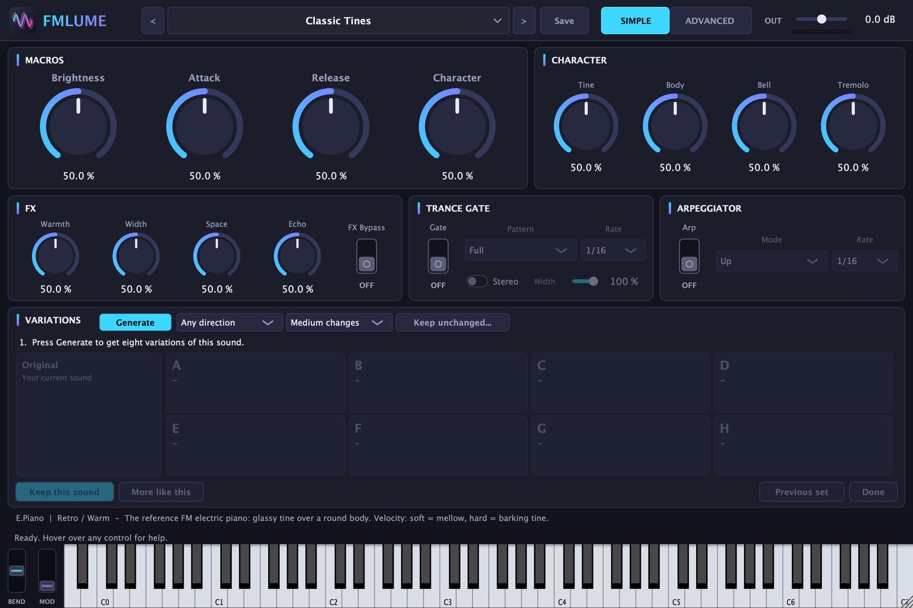
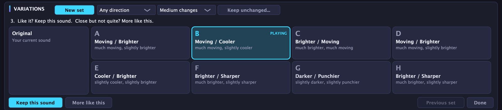
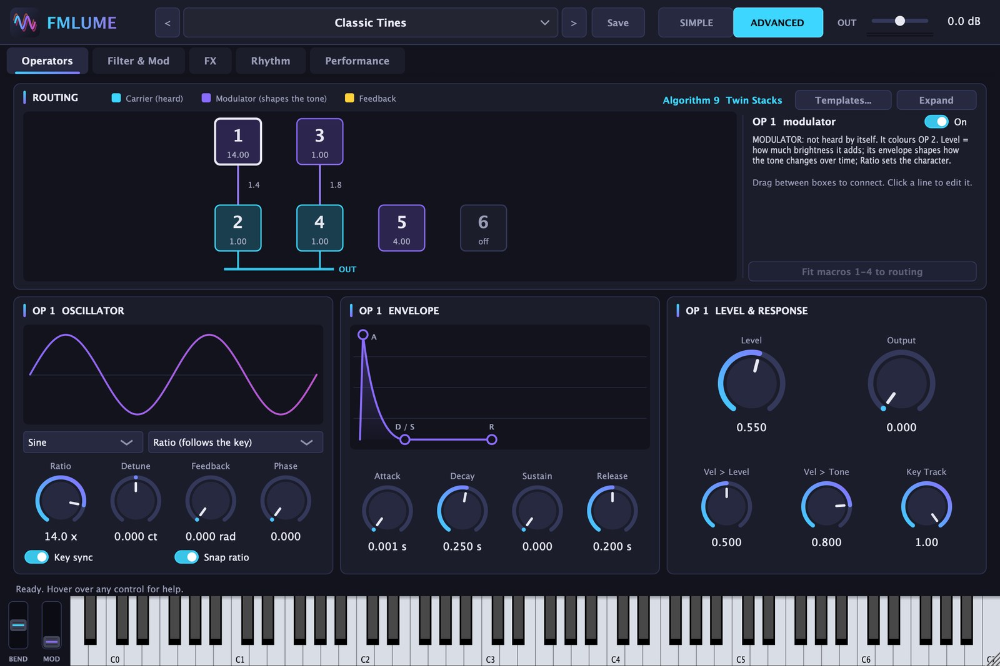
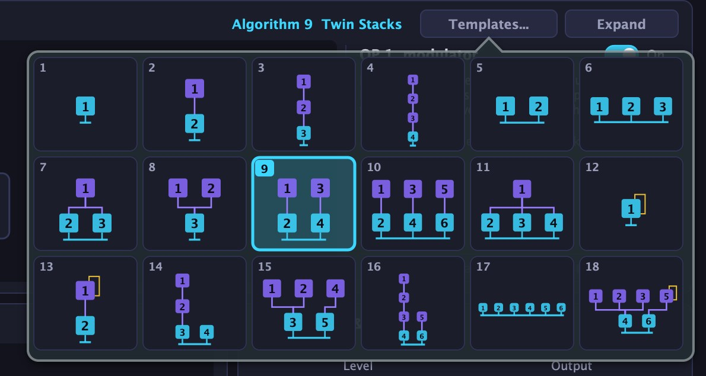
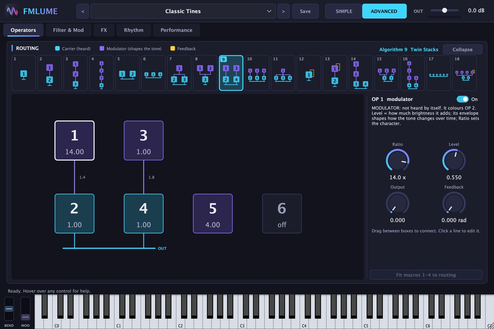
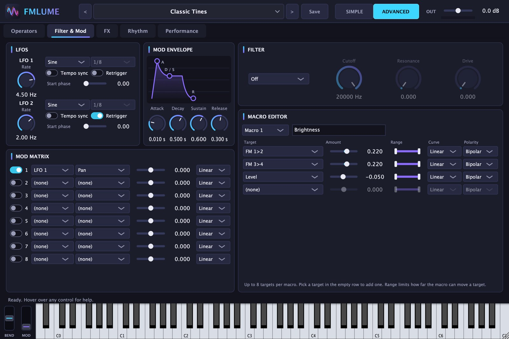
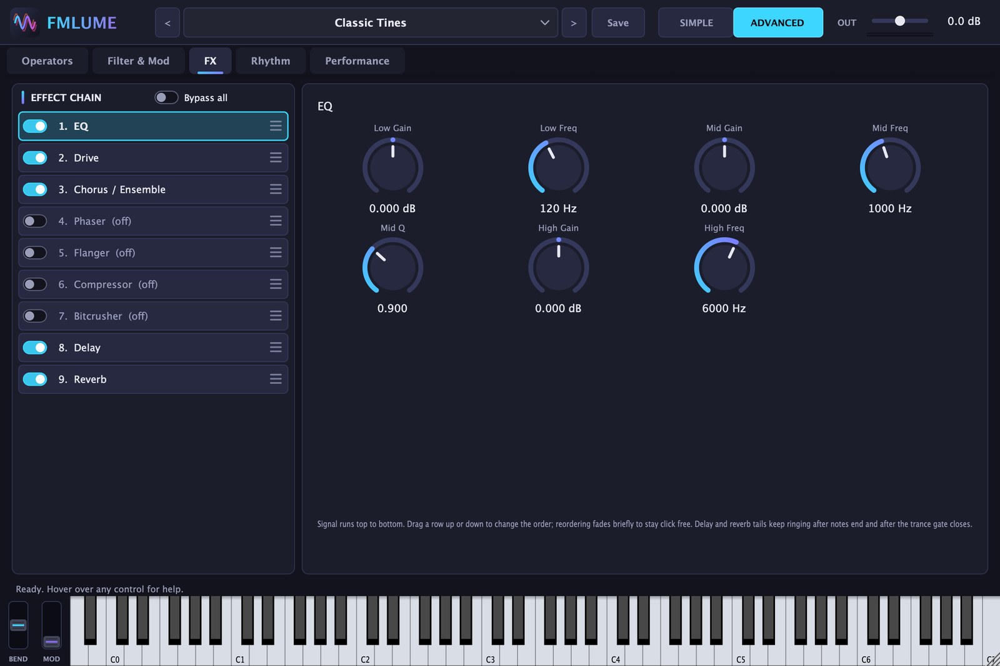
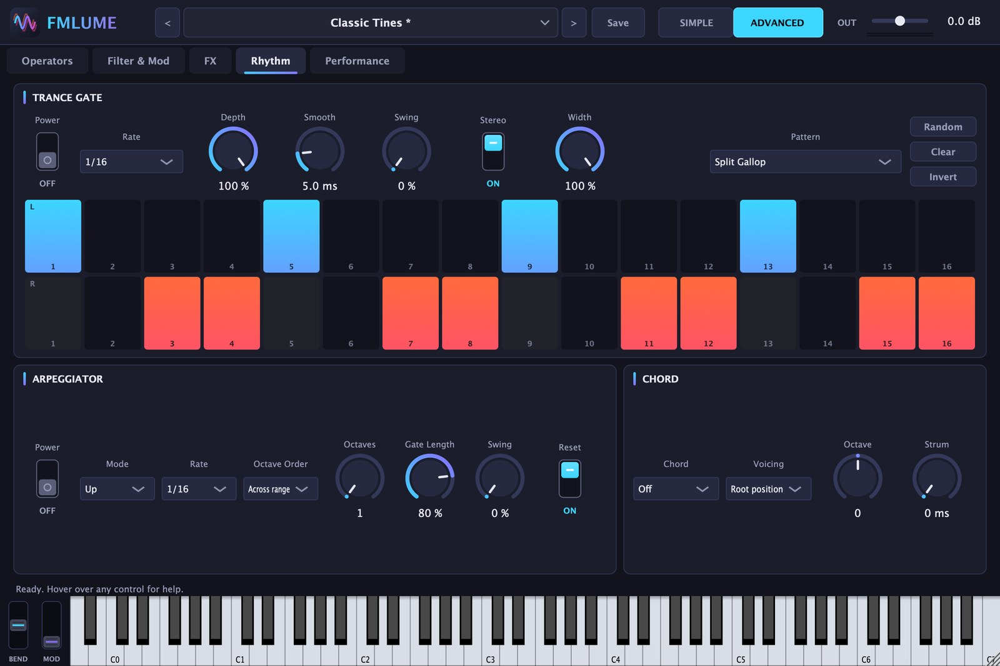
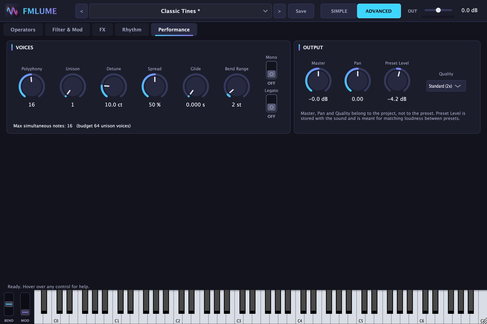
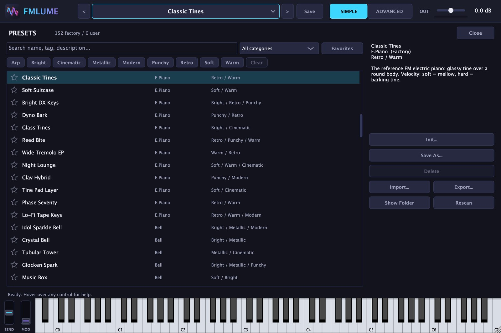

# FMLUME ユーザーガイド

FMLUME（エフエムリューム）は、FM 音源の音を、オペレーターやアルゴリズムを知らなくても作れるようにした macOS 用のシンセサイザーです。6 オペレーターの FM 音源に、マクロ、Variations（音色の候補づくり）、エフェクト、トランスゲート、アルペジエーターを備えています。
このガイドは v0.1.0 に対応しています。

> **お読みください**: 自動テストと検証ツール（auval / pluginval）は通っています。DAW での動作は、Cubase（VST3）で読み込み・演奏・保存と復元・オートメーション・キー操作・オフライン書き出しを確かめています。Logic Pro（Audio Unit）でも動作を確かめています。そのほかの DAW では、まだ確かめていません。収録音色は作者が 2 回通して試聴し、指摘した点を直しています。

## 1. 動作環境

| 項目 | 内容 |
|---|---|
| OS | macOS 12 以降 |
| CPU | Apple Silicon。Intel Mac でも動くように作っています（Universal ビルド）が、実機ではまだ試せていません |
| 形式 | Audio Unit（Logic Pro など）、VST3（Cubase など）、Standalone アプリ |
| 入出力 | MIDI 入力、ステレオ出力（音声入力なし） |
| サンプルレート | 44.1〜192 kHz（自動テストで確認） |

Cubase は Audio Unit に対応していないため、Cubase では VST3 を使います。
ライセンスは GNU AGPL v3.0 です。

## 2. インストール

[GitHub のリリースページ](https://github.com/cheebow/FMLUME/releases/latest)からインストーラー（`.pkg`）をダウンロードして開き、画面の案内に沿って進めてください。VST3、Audio Unit、Standalone アプリの中から、入れたいものを選べます。次の場所に入ります。

| 形式 | 場所 |
|---|---|
| VST3 | `/Library/Audio/Plug-Ins/VST3/FMLUME.vst3` |
| Audio Unit | `/Library/Audio/Plug-Ins/Components/FMLUME.component` |
| Standalone | `/Applications/FMLUME.app` |

インストーラーは Apple の公証を受けています。

インストール後、DAW でプラグインを再スキャンしてください。メーカー名は **CHEEBOW**、種類はインストゥルメントです。

アンインストールは、上の 3 つを削除します。ユーザープリセットとお気に入りは `~/Library/Application Support/FMLUME/Presets/` にあります。

## 3. 最初の音を出す

1. DAW でインストゥルメントトラックを作り、FMLUME を挿します（Standalone ならアプリを起動し、左上の Options からオーディオ / MIDI デバイスを選びます）。
2. 画面上部のプリセット名をクリックしてブラウザーを開き、音色を選びます。`<` `>` で前後の音色に移れます。
3. 鍵盤を弾きます。画面下の鍵盤（88 鍵）をクリックしても鳴ります。鍵盤の左にある **BEND**（ピッチベンド。上下にドラッグし、離すと中央へ戻ります）と **MOD**（モジュレーションホイール。離した位置に残ります）もマウスで動かせます。どちらもダブルクリックで 0 に戻ります。外部の MIDI キーボードのホイールを動かすと、画面のホイールも一緒に動きます。
4. Simple 表示の大きなノブ（マクロ）を回して、音を好みに近づけます。

## 4. 画面の構成

上部のバーは常に表示されます。

| 部品 | 働き |
|---|---|
| `<` `>` | 前 / 次のプリセット（一覧の端まで行くと反対の端へ戻ります） |
| プリセット名 | クリックでブラウザーを開く（もう一度クリック、Close、または SIMPLE / ADVANCED を押すと閉じる）。変更があると名前の後ろに `*` が付く |
| Save | いまの音を User プリセットとして保存（名前を入れるダイアログが開きます。7 章） |
| SIMPLE / ADVANCED | 表示の切り替え。**切り替えても音は変わりません**（同じ設定を 2 通りに見せているだけです） |
| OUT | 全体の出力音量（−60〜+12 dB）。**プリセットを切り替えても変わりません**（音色には含まれません）。DAW のプロジェクトには保存されます。スライダーの下の 2 本の細い線は出力メーター（上が左、下が右）で、赤くなり `LIMIT` と出たら、音が大きすぎて丸められています |

鍵盤のすぐ上の行（ステータス行）には、操作の結果やエラーが短く表示されます。部品にマウスを置くと、説明（ツールチップ）が出ます。

ウインドウの右下をドラッグすると、大きさを変えられます（960×660 〜 1920×1240）。

### ノブの操作

- 上下（または左右）にドラッグで変更、**Shift を押しながら**で微調整
- **Option を押しながらクリック**で初期値に戻す
- **ダブルクリック**、またはノブの下の値をクリックすると、数値を直接入力できる
- **右クリック**で「Reset to default」（初期値に戻す）と「Type a value...」（数値入力）のメニュー

OUT スライダーだけは、ダブルクリックで 0 dB に戻ります（数値の入力は値の表示をクリックします）。

## 5. Simple 表示

普段はここだけで足ります。

- **Macros**: 大きな 4 つのノブ（マクロ 1〜4）。すべての音色で **Brightness**（明るさ）、**Attack**（立ち上がり）、**Release**（余韻）、**Character**（音の癖）です。
- **Character**: マクロ 5〜8。名前と効き方は音色のカテゴリごとに違います（例: E.Piano なら Tine / Body / Bell / Tremolo。7 章の表）。

マクロはどれも中央（50 %）が音色の基準の状態で、そこから左右に回すと変わります。何も割り当てられていないマクロは薄く表示されます。ノブにマウスを置くと、そのマクロが動かす設定の一覧が出ます。割り当ては Advanced の Filter & Mod タブ（Macro Editor）で変えられます。

- **FX**: 4 つのノブで、エフェクトをまとめて動かします。50 % がその音色の設定のままの状態です。

| ノブ | 動かすもの |
|---|---|
| Warmth | Drive と、EQ の低域・高域のバランス |
| Width | Chorus の量とステレオの広がり |
| Space | Reverb の量と長さ |
| Echo | Delay の量と繰り返し |

  対応するエフェクトが Advanced の FX タブでオフになっているときは効きません（収録音色では、この 4 つに関係するエフェクトはオンになっています）。**FX Bypass** を ON にすると、すべてのエフェクトを通さなくなります（各エフェクトの ON/OFF の設定は残ります）。

- **Trance Gate**: **Gate** スイッチで ON。**Pattern**（パターン）と **Rate**（1 ステップの長さ）を選べます。ウインドウに余裕があれば、**Stereo** と **Width** も表示されます。細かい編集は Advanced の Rhythm タブで行います。
- **Arpeggiator**: **Arp** スイッチで ON。**Mode**（順番）と **Rate** を選べます。
- 最下行に、カテゴリ、タグ、音色の説明が表示されます。

### Variations

いまの音を元に、少しずつ違う音色の候補を 8 つ作ります。

1. **Generate** を押すと、候補 A〜H が作られます。候補はできた順にタイルに現れます（待っている間もほかの操作はできます）。
2. タイルをクリックすると、その候補で短い和音（C4 と G4）が鳴ります。別のタイルを選ぶまでは、鍵盤もその候補の音で鳴ります。**Original** を押すと、元の音に戻ります。
3. 気に入ったら **Keep this sound** で、いまの音として採用します。近いけれど少し違う、というときは **More like this** で、その候補を元に新しい 8 つを作ります。

| 部品 | 働き |
|---|---|
| 方向（Any direction） | Brighter / Darker / Warmer / More Metallic / Softer / Punchier / More Motion の中から、候補を寄せる方向を選ぶ。必ずそう聞こえるとは限らない目安です |
| 変化の大きさ | Subtle changes / Medium changes / Wild changes。Wild では結線やモジュレーターの比率も変わることがある |
| Keep unchanged... | 変えたくない部分を選ぶ（Operator routing and waveforms、Pitch ratios、Envelopes、Effects、各マクロ）。選んだ数がボタンに `(2)` のように出る |
| New set | 同じ元の音から、別の 8 つを作り直す（Generate を押したあとはこの名前になります） |
| Previous set | 1 つ前の候補の組に戻る（20 組まで） |
| Done | 候補を閉じて、いまの音に戻る |

- **Keep this sound を押すまで、いまの音は変わりません**。押すと元の音は置き換わります。元の音を残したいときは、先に Save で保存してください。採用した音はまだ保存されていないので、残すなら Save します。
- 採用しても、Rhythm タブの設定（Arp、Chord、Trance Gate）、マクロの位置、Unison などは変わりません。
- 候補は、元の音と同じくらいの大きさに聞こえるように、音量（Performance タブの Preset Level）を合わせてあります。合わせきれない候補は出しません。
- タイルの説明に `(safe fallback)` と出る候補は、条件に合う候補が作れなかったときに代わりに作った、小さな変化の候補です。
- 候補を試聴している途中でノブなどを動かすと、試聴は終わり、元の音への編集になります。プリセットを読み込むと、候補は閉じます。

## 6. Advanced 表示

5 つのタブで、すべての設定を編集できます。

### Operators

FM の音は、6 つのオペレーター（OP 1〜6）のつなぎ方で決まります。**キャリア**（Carrier）は直接聞こえる音、**モジュレーター**（Modulator）は、つないだ先の音色を変える（明るさや金属っぽさを足す）役目です。上段が結線図（Routing）、下段が選んだオペレーターの設定です。

**結線図**

- 箱をクリックすると、そのオペレーターを選びます。下段と右側の表示が切り替わります。
- 箱から別の箱へドラッグすると、つながります（ドラッグ元が、ドラッグ先を変調します）。ループになる接続と、すでにある接続はできません。
- 線をクリックすると、その接続を選びます。右側に `Connection 1 > 2` と **FM Amount**（変調の深さ、0〜16）、**Remove**（接続を消す）が出ます。
- キャリアは下の段に並び、`OUT` の線につながります。箱の中の数字は Ratio（Fixed のときは Hz）です。オフのオペレーターは薄く表示されます。
- 見出しの行に、凡例（Carrier (heard) / Modulator (shapes the tone) / Feedback）と、いまの結線に当たるテンプレートの名前（`Algorithm 5  Dual Carrier` など。どれにも当たらなければ `Custom routing`）が出ます。

**右側**

- 選んだオペレーターの番号と役割（carrier / modulator / off）、**On** スイッチ（オペレーターのオン / オフ）、役割の説明。
- **Fit macros 1-4 to routing**: マクロ 1〜4（Brightness / Attack / Release / Character）が、いまの結線に合わせて働くように割り当て直します。手で結線を変えたあとに使います。確認のダイアログで **Fit** を押すと実行します。Macro Editor でマクロ 1〜4 に設定した割り当ては置き換わります（マクロ 5〜8 とノブの位置は変わりません）。割り当て直しても何も変わらないときは、押せない状態になります。

**Templates... / Expand**

- **Templates...**: 18 種類の結線のテンプレートから選びます。変わるのは、つなぎ方、使うオペレーター（使わないものはオフ）、どれがキャリアか、フィードバックの有無です。各オペレーターの比率やエンベロープなどはそのまま残り、すでにあった接続の深さも引き継がれます。マクロ 1〜4 も自動で割り当て直されます。

- **Expand**: 結線図をタブ全体に広げます。テンプレートが上に一列で並び、右側に選んだオペレーターの Ratio / Level / Output / Feedback が出ます。**Collapse** で元に戻ります。

**下段（OP n）**

| パネル | 設定 |
|---|---|
| Oscillator | 波形の図（表示のみ）、波形（Sine / Triangle / Saw / Pulse）、音程の決め方（Ratio (follows the key) / Fixed Hz。Fixed Hz にすると鍵盤に関係なく同じ高さ）、**Key sync**（ON: 弾くたびに Phase の位置から始まる）、**Snap ratio**（ON: Ratio のノブが 0.5 刻み、1 未満では 1/8 刻みに止まる。数値入力には効きません）。ノブは **Ratio**（または **Fixed Hz**）、**Detune**（±100 セント）、**Feedback**（自分自身への変調）、**Phase** |
| Envelope | 音量（モジュレーターなら音色）の時間変化。図の点をドラッグして変えられます（1 つ目: Attack の時間、2 つ目: 左右で Decay の時間・上下で Sustain の高さ、3 つ目: Release の時間）。下の 4 つのノブでも同じ値を変えられます |
| Level & Response | **Level**（キャリアなら音量、モジュレーターなら掛かる強さ）、**Output**（そのオペレーターを直接聞かせる量。0 より大きいとキャリアになる）、**Vel > Level**（弱く弾くと音量が下がる度合い）、**Vel > Tone**（弱く弾くと、このオペレーターが掛ける変調が弱まる度合い）、**Key Track**（音程が鍵盤にどれだけ付いていくか） |

### Filter & Mod

**Filter**: 種類（Off / Low-pass 12 dB / Low-pass 24 dB / High-pass 12 dB / Band-pass 12 dB）と、**Cutoff**、**Resonance**、**Drive**。Off のときノブは薄く表示されます。フィルターは全部の音に 1 つだけ掛かります（音ごとではありません）。

**LFOs**（LFO 1 / LFO 2）: 周期的に揺れる信号です。それだけでは音は変わらず、Mod Matrix で行き先を決めて使います。

| 設定 | 内容 |
|---|---|
| 波形 | Sine / Triangle / Saw / Square / Random |
| Rate | 速さ（0.02〜20 Hz） |
| Tempo sync / 分割 | ON にすると、テンポに合わせた長さ（1/1〜1/64、付点と 3 連を含む）で揺れる |
| Retrigger | 弾くたびに Start phase の位置から始める |
| Start phase | 揺れの開始位置 |

**Mod Envelope**: 弾くたびに動く、もう 1 つのエンベロープです。図の点のドラッグ、または Attack / Decay / Sustain / Release のノブで変えます。これも Mod Matrix で行き先を決めて使います。

**Mod Matrix**: 8 つの枠で、「何で（ソース）」「何を（行き先）」「どれだけ」動かすかを決めます。

- 左端の番号のスイッチで、その枠を有効にします。
- ソース: LFO 1 / LFO 2 / Mod Env / Velocity / Key Track / Mod Wheel / Aftertouch / Macro 1〜8
- 行き先: FM の接続の深さ（FM amounts）、オペレーターの Detune / Level、フィルターの Cutoff / Resonance、Pitch / Level / Pan、エフェクトの Wet など。いまある接続とオンのオペレーター・エフェクトだけが選べます。Mod Matrix が新しい接続を作ることはありません。
- 深さ（−1〜+1。1 で行き先の範囲いっぱい）と、効き方のカーブ（Linear / Exp / S-Curve）。Pitch は ±12 半音の範囲なので、小さな値でもはっきり動きます。

**Macro Editor**: マクロの中身を編集します。

- 左のメニューでマクロ（Macro 1〜8）を選び、右の欄に名前を入れて Return（24 文字まで）。名前は Simple 表示のノブに出ます。DAW のオートメーションでの名前は「Macro 1」などのままです。
- 空いている行で **Target**（動かす設定）を選ぶと、割り当てが増えます。1 つのマクロに 8 つまでです。外すときは Target を `(none)` にします。
- **Amount**: マクロを端まで回したときに、どれだけ動かすか（−1〜+1。1 で設定の範囲いっぱい）。
- **Range**: 動かせる範囲を、設定の範囲の何 % から何 % までに制限します（両端をドラッグ）。
- **Curve**: Linear / Exp / S-Curve。**Polarity**: Bipolar / Unipolar。
- どの割り当ても、マクロが 50 % のときは何も動かしません。
- 割り当てられるのは連続的に変わる設定だけです（波形、結線、エフェクトの種類などは対象外）。

### FX

9 種類のエフェクトが、左の一覧の上から順に掛かります。

- 行をクリックすると、そのエフェクトの設定が右に出ます。行の左のスイッチで ON/OFF します。オフのエフェクトは処理されません。
- 行を上下にドラッグすると、順番を入れ替えられます。入れ替えの瞬間は、ノイズを避けるために音が一瞬小さくなります。
- 一覧の見出しの **Bypass all** は、Simple の FX Bypass と同じスイッチです。

| エフェクト | 設定 |
|---|---|
| EQ | Low Gain / Low Freq、Mid Gain / Mid Freq / Mid Q、High Gain / High Freq |
| Drive | Gain、Tone、Wet、Trim |
| Chorus / Ensemble | Rate、Depth、Width、Wet、Voices（1〜4） |
| Phaser | Rate、Depth、Feedback、Wet |
| Flanger | Rate、Depth、Feedback、Wet |
| Compressor | Threshold、Ratio、Attack、Release、Makeup、Wet |
| Bitcrusher | Bits、Downsample、Wet |
| Delay | Time、Feedback、Stereo、Wet、**Tempo sync**（ON にすると Time の代わりに、その下のメニューの長さを使う） |
| Reverb | Size、Decay、Pre Delay、Damping、Wet |

Delay と Reverb の余韻は、音を離したあとも、Trance Gate が閉じたあとも鳴り続けます。

### Rhythm

**Trance Gate** は、音量を 16 ステップのパターンで刻みます。

- **Power** で ON。Simple の Gate スイッチと同じです。
- グリッドを**クリック**（またはなぞる）とステップの ON/OFF、**Option を押しながら上下にドラッグ**（または右ボタンでドラッグ）すると、そのステップの高さ（音量）を変えられます。
- **Rate**（1 ステップの長さ。1/4〜1/64、付点と 3 連を含む）、**Depth**（刻みの深さ）、**Smooth**（切り替わりのなめらかさ、0〜30 ms）、**Swing**（0〜60 %）。
- **Stereo** を ON にすると、グリッドが上下 2 段（上が左、下が右）になり、左右で別のパターンを組めます。**Width** を下げると左右の差が小さくなり、0 % では左右とも同じ動きになります。
- **Pattern**: 52 種類のパターン（Basic / Straight / Trance / Fast 1/32 / Syncopated / Accent / Fill / Stereo）。選ぶと Rate もそのパターンに合う値になり、Stereo グループを選ぶと Stereo が ON になります。手で編集すると `Custom` と表示されます。
- **Random**（ランダムなパターン。1 ステップ目は必ず開く）、**Clear**（全部開く）、**Invert**（開閉を反転）。元に戻す機能はありません。
- Gate はエフェクトの手前に掛かります。FX Bypass では切れません。

**Arpeggiator** は、押さえた和音を 1 音ずつ順に鳴らします。

- **Power** で ON。Simple の Arp スイッチと同じです。
- **Mode**: Up / Down / Up-Down / Random / As played（押した順）
- **Rate**: 1/4〜1/32T。**Octaves**（1〜4）、**Gate Length**（1 音の長さ、5〜100 %）、**Swing**（0〜60 %）
- **Octave Order**: Across range（すべてのオクターブを通して順に。ド ミ ソ ド' ミ' ソ'）/ Step up / Step down / Step up-down（1 オクターブの中で一回り弾いてから、オクターブを移る）
- **Reset**: ON にすると、DAW を止めたときにパターンを最初からにします。
- 鍵盤をすべて離すと止まります（押さえたままにする Latch はありません）。

**Chord** は、1 つの鍵盤で和音を鳴らします。

- **Chord**: Off / Major / Minor / Sus2 / Sus4 / Dim / Aug / 7 / m7 / maj7
- **Voicing**: Root position / 1st inversion / 2nd inversion
- **Octave**（和音全体を −2〜+2 オクターブ移す）、**Strum**（構成音を少しずつずらして鳴らす、0〜100 ms）
- Arpeggiator と一緒に使うと、和音に広げた音がアルペジオになります。

### Performance

**Voices**

| 設定 | 内容 |
|---|---|
| Polyphony | 同時に鳴らせる音の数（1〜32） |
| Unison | 1 音に重ねる数（1〜8） |
| Detune / Spread | 重ねた音のずれ（0〜50 セント）と、左右の広がり |
| Glide | 前に弾いた音から、音程がなめらかに移る時間（0〜2 秒） |
| Bend Range | ピッチベンドの幅（1〜24 半音、上下同じ）。音色に保存されます |
| Mono | 1 音ずつ鳴らす（後から弾いた音が優先） |
| Legato | Mono のとき、鍵盤を押さえたまま次を弾くと、アタックし直さずに音程だけ移る |

下に、いまの設定で同時に鳴らせる最大の音の数が表示されます。Unison を重ねた合計は 64 までなので、Unison を増やすと同時に鳴らせる数が減ることがあります。

**Output**

- **Master**: 上部の OUT と同じ設定です。**Pan**: 全体の左右の位置。
- **Preset Level**: その音色の音量の補正（−24〜+12 dB）。プリセットに保存されます。自分で作った音色がほかより大きい / 小さいときは、OUT ではなくこちらで合わせます。
- **Quality**: FM 音源の内部処理の細かさ。Eco (1x) / Standard (2x) / High (4x)。上げると高音の濁り（折り返しノイズ）が減り、CPU の負荷と遅れ（数サンプル。DAW に報告されます）が増えます。切り替えるとき、鳴っている音は短くフェードします。

Master、Pan、Quality はプロジェクトの設定で、プリセットを切り替えても変わりません。

## 7. プリセット

ブラウザーでは次のことができます。

| 操作 | 内容 |
|---|---|
| 検索 | 名前・説明・タグ・カテゴリ・作者から探す（複数の語はすべてを含むものに絞る）。Esc でブラウザーを閉じる |
| カテゴリ / Favorites | カテゴリやお気に入りで絞り込む |
| タグのボタン | 音色に付いているタグで絞り込む（一度に 1 つ）。**Clear** で解除 |
| 行の左端の ★ | クリックでお気に入りに入れる / 外す（音色は切り替わりません） |
| 行のクリック | その音色を読み込む |
| Init... | カテゴリを選んで、そのカテゴリの出発点の音色（`Init Bell` など）から作り始める。一覧の音色ではないので、作った音は保存する |
| Save As... | 名前を付けて User プリセットとして保存（上部の Save と同じ） |
| Delete | 選んでいる User プリセットを削除（Factory は削除できません）。確認のダイアログで Delete を押すと消えます |
| Import... | `.fmlume` ファイルを User プリセットとして取り込み、読み込む |
| Export... | いまの音を `.fmlume` ファイルに書き出す |
| Show Folder / Rescan | User プリセットのフォルダーを Finder で開く / フォルダーを読み直す |

**保存について**

- Save（Save As...）では名前だけを入れます。カテゴリ、タグ、説明は、いまの音色のものを引き継ぎます。
- 同じ名前の User プリセットがあるときは、上書きしてよいか確認します。Factory プリセットが上書きされることはありません。
- 新しいバージョンの FMLUME で作ったプリセットも開けます。このバージョンにない設定（新しいエフェクトなど）は使わずに読み込み、そのことをステータス行で知らせます。そのため、作ったときと同じ音にならないことがあります。
- 取り込んだファイルは、元のファイルとは別の User プリセットになります。同じ名前がすでにあれば、`名前 2` のように番号が付きます。古い形式のファイル（以前のビルドの、2 つの音を切り替える Morph 機能を使ったもの）は、1 つ目の音だけを読み込み、そのことをステータス行で知らせます。

**プリセットを切り替えたときに変わるもの**: 音色のすべての設定に加えて、マクロとエフェクト（Warmth など）のノブの位置、Polyphony / Unison / Detune / Spread、Arp と Gate の ON/OFF。**変わらないもの**: OUT（Master）、Pan、Quality、FX Bypass。

収録している Factory プリセットは 152 音色です。マクロ 1〜4 はすべての音色で共通、マクロ 5〜8 はカテゴリごとに違います（下の表は主な名前で、音色によって一部違うことがあります）。**Arp** カテゴリの音色は、読み込むと Arpeggiator が ON になり、和音を押さえるだけでアルペジオが鳴ります（DAW を再生していなくても、Standalone でも動きます）。

| カテゴリ | 数 | マクロ 5〜8 |
|---|---|---|
| Arp | 30 | 音色の種類による（Snap / Body / Damping / Space など） |
| E.Piano | 12 | Tine / Body / Bell / Tremolo |
| Bell | 13 | Metallic / Shimmer / Decay / Motion |
| Bass | 12 | Growl / Punch / Weight / Drive |
| Lead | 12 | Bite / Glide / Edge / Width |
| Pad | 12 | Softness / Width / Movement / Air |
| Poly | 13 | Sweep / Detune / Sub / Motion |
| Pluck | 12 | Snap / Body / Damping / Space |
| Brass | 12 | Bite / Body / Attack Shape / Ensemble |
| Keys | 12 | Digital / Body / Ring / Width |
| SFX | 12 | Chaos / Pitch Sweep / Texture / Tail |

DAW のプロジェクトには、プリセット名だけでなく**すべての設定**が保存されます（編集済みの `*` も残ります）。プリセットファイルを消しても、プロジェクトの音色は変わりません。

## 8. MIDI

| MIDI | 働き |
|---|---|
| ノート | Polyphony の数まで（最大 32）。足りなくなると、離したあと余韻が残っている音、次に最も古い音から止めます |
| ベロシティ | 各オペレーターの Vel > Level / Vel > Tone の量だけ、音量と音色が変わる。Mod Matrix のソース Velocity にもなる |
| ピッチベンド | Performance タブの Bend Range の幅で上下 |
| CC1（モジュレーション） | Mod Matrix のソース Mod Wheel。何に効くかは音色ごとで、割り当てのない音色では変化しません（収録音色では 8 音色が使っています） |
| アフタータッチ（チャンネルプレッシャー） | Mod Matrix のソース Aftertouch（収録音色では使っていません） |
| CC64（サステイン） | 音を伸ばす |
| CC120 / CC123 | すぐに消音 / すべての音をリリース |

ほかの CC とプログラムチェンジには反応しません（MIDI でマクロを動かすには、DAW 側でマクロのパラメーターに割り当ててください）。MPE には対応していません。MIDI チャンネルは区別しません。

## 9. DAW との連携

- Trance Gate、Arpeggiator、LFO と Delay の Tempo sync は DAW のテンポに合います。テンポが得られない場合は 120 BPM で動きます。DAW を止めている間も、内部の時計で動き続けます（Arpeggiator は最初の鍵盤で、すぐにパターンの頭から始まります）。
- DAW に公開しているパラメーターは 22 個です: Master Gain、Master Pan、Polyphony、Unison Voices、Unison Detune、Stereo Spread、Quality、Macro 1〜8、FX Bypass All、FX Warmth / Width / Space / Echo、Arp Enabled、Trance Gate Enabled。オペレーターなどの細かい設定を DAW で動かしたいときは、マクロに割り当てて、そのマクロをオートメーションします。
- DAW の Undo（取り消し）が効くのは、上の 22 個のパラメーターだけです。
- Quality に応じた遅れ（レイテンシー）を DAW に報告しています。

## 10. 困ったとき

| 症状 | 確認すること |
|---|---|
| 音が出ない | OUT の値。Operators タブでキャリア（Output が 0 より大きいオペレーター）が On になっているか。Filter の Cutoff が極端に低くないか。Gate が閉じたパターンになっていないか |
| プラグインが一覧に出ない | DAW の再スキャン。Cubase では VST3 フォルダー、Logic では Audio Unit の検証結果を確認 |
| 鍵盤を離しても音が続く | Delay / Reverb の余韻、Release の長さ、サステインペダル（CC64）を確認 |
| 編集を元に戻したい | 取り消し（Undo）の機能はありません。プリセットを読み直すか、Variations の試聴中なら Original に戻ります。大きく変える前に Save で保存しておくと安心です |
| DAW のキー操作（スペースキーでの再生など）が効かない | FMLUME は、文字の入力欄（検索、マクロ名、ノブの数値入力、保存のダイアログ）にカーソルがある間だけキーを受け取ります。Esc か Return で入力を終えるか、入力欄の外をクリックすると、キーは DAW に戻ります |
| 音が歪む | OUT の下のメーターに `LIMIT` が出ていたら、OUT を下げる。和音や Unison を重ねたときに出やすくなります。Drive、Filter の Drive、Feedback、FM Amount を下げる。出力には安全用のリミッターがあり、大きすぎる音は丸められます |
| 音色によって音量がばらつく | 自分の音色は Performance タブの Preset Level で合わせる |
| プロジェクトを開いたら音色が違う | ステータス行に理由が表示されます（保存されていたデータを読めなかった場合、いまの音色のまま残します） |

## 11. 現在の制限

- Windows、AAX、CLAP、AUv3 には対応していません。Intel Mac は実機で確かめていません。
- 編集の取り消し（Undo / Redo）はありません。
- MPE、ポリフォニックアフタータッチ、MIDI ラーン、アルペジオの MIDI 出力はありません。
- フィルター、LFO、Mod Envelope は全部の音で共通の 1 系統です（音ごとに別々には動きません）。Mod Matrix のソース Velocity と Key Track は、最後に弾いた音の値です。
- Arpeggiator に Latch（離しても鳴り続ける機能）はありません。
- プリセットを切り替えた瞬間、前の音の余韻にも、新しいプリセットの音量やフィルターがすぐに掛かります。
- エフェクトの並べ替えは、クロスフェードではなく一瞬音量を下げて行います。
